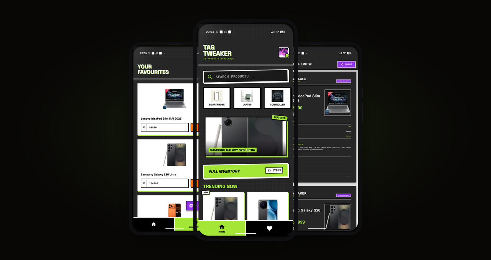
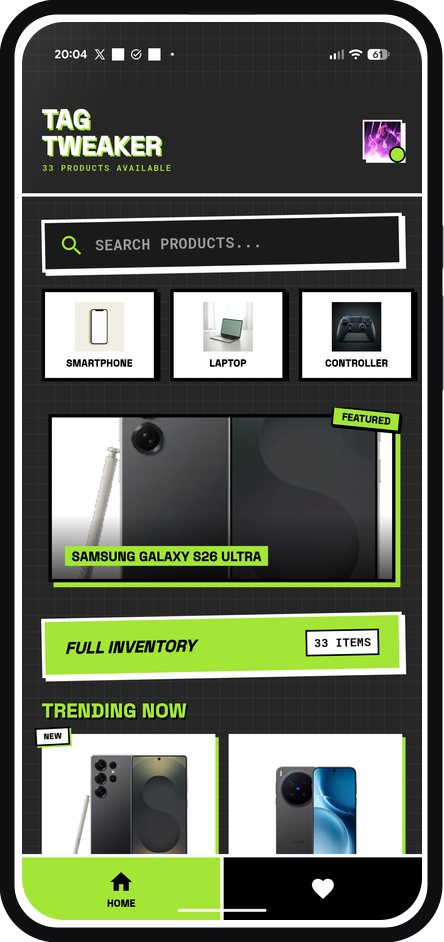
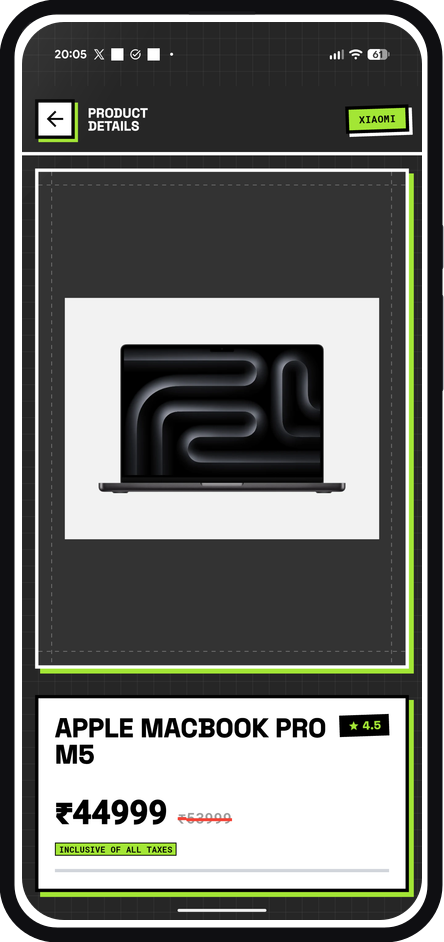
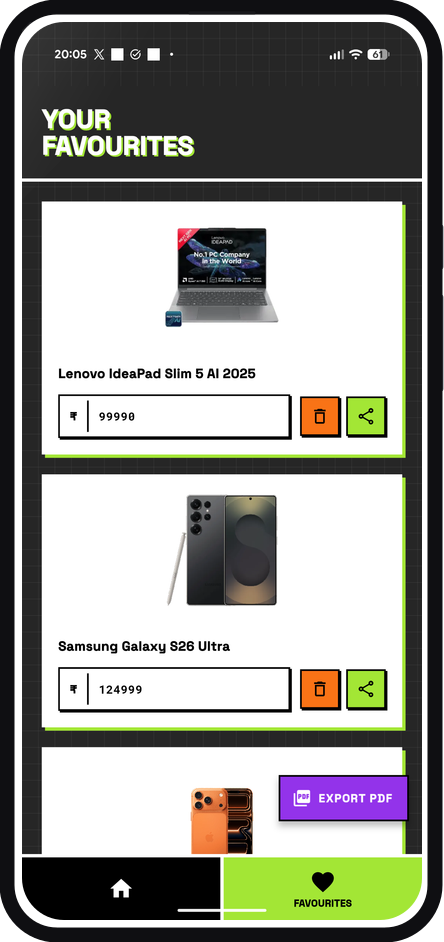
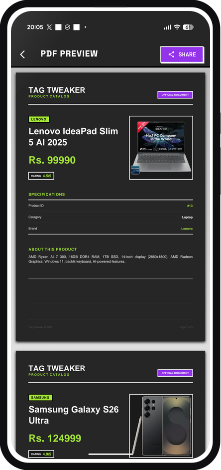
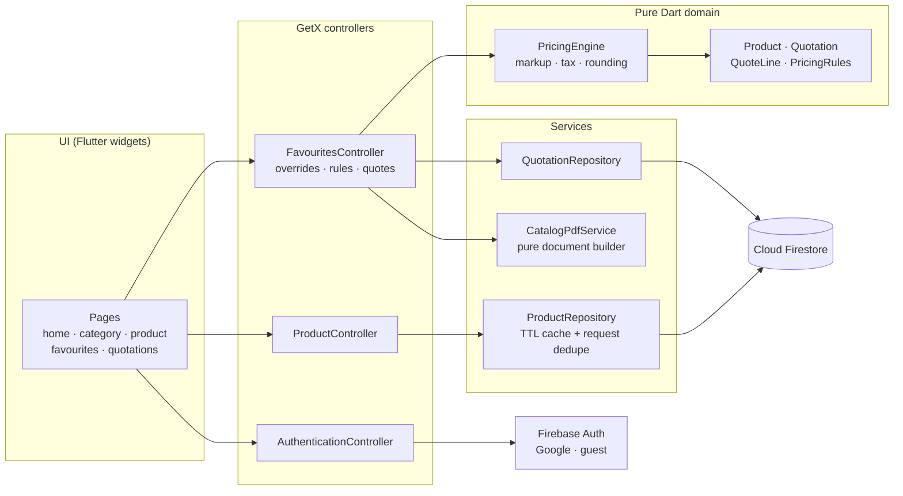

<div align="center">

# 🏷️ Tag Tweaker

**Product catalog, client quotations with pricing rules & on-device PDF generation**

[**⬇ Download the latest APK**](https://github.com/ChromaBeast/tagtweaker/releases/latest)

[](https://github.com/ChromaBeast/tagtweaker/actions/workflows/ci.yml)
[](https://codecov.io/gh/ChromaBeast/tagtweaker)
[](https://flutter.dev)
[](https://firebase.google.com)
[](https://github.com/ChromaBeast/tagtweaker/releases/latest)
[](LICENSE)

<br/>



</div>

---

## ⚡ Overview

**Tag Tweaker** is a bold, high-performance mobile catalog creator built with a distinctive **Neo-Brutalist** aesthetic. Designed for small businesses, retailers, and wholesalers, it allows merchants to browse inventory, build client quotations with markup, tax and rounding rules (or hand-tuned prices), keep a history of every quote sent, and compile ready-to-share PDF quotations directly on-device in under **400ms**.

---

## 📱 App Walkthrough & Screenshots

<div align="center">

| 🏠 Catalog Feed | 📱 Product Details | ⚡ Price Tweaker | 📄 PDF Output |
| :---: | :---: | :---: | :---: |
|  |  |  |  |
| **Catalog Feed**<br/>Fast browsing by category with inventory counts | **Product Details**<br/>Multi-image carousel & deep technical specs | **Price Tweaker**<br/>Curate favorites & tweak client prices in real time | **PDF Output**<br/>On-device vector catalog ready for WhatsApp/print |

</div>

---

## 🚀 Key Features

* **Instant Catalog Browsing**: High-contrast Neo-Brutalist feed with snappy category filtering (Smartphones, Laptops, Audio, Gaming, etc.).
* **Client Quotations with Pricing Rules**: Apply a quote-wide markup or discount, per-category markups, GST/tax and rounding (exact, ₹1, ₹10 or charm pricing ending in 9). Any price typed by hand overrides the rules for that item. A live subtotal / tax / total bar updates as you edit.
* **Quotation History**: Every quote is saved per user with its client name, line items, rules and totals. Re-export any past quote as a PDF, or swipe to delete it.
* **On-Device Vector PDF Engine**: Compiles client-ready quotation PDFs (client block, paginating line-item table, totals, then product pages at quoted prices) in `<400ms` using `pdf` + `printing`, with no server round-trip.
* **Offline-Tolerant & Cached**: Persistent image caching with `CachedNetworkImage`, plus an in-memory TTL cache in front of Firestore that deduplicates concurrent requests and falls back to stale data on network errors.
* **Locked-Down Backend**: Schema-validated Firestore and Storage security rules, covered by emulator-backed tests.
* **50%+ Slashed App Footprint**: Slashed APK bundle size from **55MB+** down to **26.7MB** through ABI splitting, WebP image asset compression, and modular tree-shaking.
* **Modern Android Toolchain**: Powered by **AGP 8.11.1**, **Kotlin 2.2.20**, and **Gradle 8.14.2** with zero deprecation warnings.

---

## 🏗️ Architecture



**Design decisions**

* **Pricing logic is pure Dart.** `PricingEngine` has no Flutter or Firebase imports, so every rule (category overrides, charm rounding, tax rounding to paise, input parsing) is unit-tested directly.
* **Dependencies are injected.** Repositories and controllers take `FirebaseFirestore` / `FirebaseAuth` (and a clock) as optional constructor arguments, so tests run against `fake_cloud_firestore` and `firebase_auth_mocks` with no network.
* **An in-memory cache in front of Firestore.** Firestore's own cache is per document. The repository caches whole query results with a 10-minute TTL, bounds the search cache (LRU, 50 entries), and shares in-flight futures so a pre-warm and the first build never issue the same read twice.
* **Quotations are immutable snapshots.** Each quote stores the quoted unit prices and the rules used, so later catalog price changes never rewrite history. The security rules forbid updates.
* **PDFs are built on the device.** `CatalogPdfService.buildDocument` is a pure function from models to bytes: fast, private (client prices never leave the phone), and testable.

### Data model

```
products/{productId}                      read-only catalog (seeded with admin SDK)
users/{uid}                               displayName, photoURL
users/{uid}/favourites/{productId}        product snapshot
users/{uid}/quotations/{quoteId}          clientName, createdAt, lines[], rules, subtotal, tax, total
users/{uid}/settings/pricing              markupPercent, categoryMarkupPercent, taxPercent, rounding
```

### Security model

[`firestore.rules`](firestore.rules) and [`storage.rules`](storage.rules) default-deny everything. Signed-in users can read the catalog but never write it. All per-user data is owner-only. Quotations and pricing settings are schema-validated (exact keys, types, bounds such as tax 0–100% and at most 200 lines), and quotations cannot be edited once saved. Profile uploads must be images under 2 MB in the owner's own folder.

---

## 🛠️ Tech Stack

* **Framework:** [Flutter](https://flutter.dev) (Dart 3.x)
* **Architecture & State:** [GetX](https://pub.dev/packages/get) with controllers, injectable services and a pure-Dart pricing domain
* **Backend:** [Firebase](https://firebase.google.com) (Authentication, Cloud Firestore, Cloud Storage)
* **Document Engine:** [pdf](https://pub.dev/packages/pdf) & [printing](https://pub.dev/packages/printing)
* **Caching & Networking:** [cached_network_image](https://pub.dev/packages/cached_network_image), [http](https://pub.dev/packages/http)
* **Visual Theme:** Neo-Brutalist design system (custom canvas grid painters, dashed lines, and high-contrast borders)
* **Testing:** `flutter_test`, `fake_cloud_firestore`, `firebase_auth_mocks`, `@firebase/rules-unit-testing` on the Firebase Emulator Suite
* **CI/CD:** GitHub Actions (format, strict analysis, tests with coverage, rules tests, APK build, signed tag releases), Dependabot

---

## 🧪 Testing

| Suite | What it covers | Run |
| --- | --- | --- |
| Unit & widget (Dart) | Pricing engine, models, money formatting, repositories (queries, TTL, dedupe, eviction), favourites controller, PDF builder, pricing-rules sheet, summary bar | `flutter test --coverage` |
| Security rules (emulator) | Catalog read-only, owner isolation, favourites/quotation/settings schemas, immutability, storage upload limits, default deny | `cd test_rules && npm ci && npm test` |
| Seed data | Catalog JSON has required fields, valid prices, unique ids | `python scripts/seed_products.py --dry-run` |

CI runs all three on every push and pull request, plus `dart format` and `flutter analyze --fatal-infos` with strict casts and raw types turned on.

---

## 📦 Getting Started

### Prerequisites
* Flutter SDK (3.38+, Dart 3.10+)
* Android Studio or VS Code with Flutter extension
* Android SDK 34+
* For rules tests and the local backend: Node 22+ and Java 21+

### Installation & Run

```bash
# Clone the repository
git clone https://github.com/ChromaBeast/tagtweaker.git
cd tagtweaker

# Install dependencies
flutter pub get

# Run on connected device
flutter run

# Build split release APKs
flutter build apk --release --split-per-abi
```

### Local backend (no Firebase project needed)

```bash
cd test_rules && npm ci
npx firebase --config ../firebase.json emulators:start --only firestore --project demo-tagtweaker

# In another terminal: seed the catalog into the emulator
pip install -r scripts/requirements.txt
python scripts/seed_products.py --emulator
```

### Releasing

Bump `version:` in `pubspec.yaml`, then push a matching tag (for example `git tag v1.2.0 && git push origin v1.2.0`). The [Release workflow](.github/workflows/release.yml) runs the tests, builds signed split APKs and publishes a GitHub Release. It needs the `ANDROID_KEYSTORE_BASE64`, `ANDROID_KEYSTORE_PASSWORD`, `ANDROID_KEY_ALIAS` and `ANDROID_KEY_PASSWORD` repository secrets.

---

## 👤 Author

* **ChromaBeast** ([@ChromaBeast](https://github.com/ChromaBeast))
